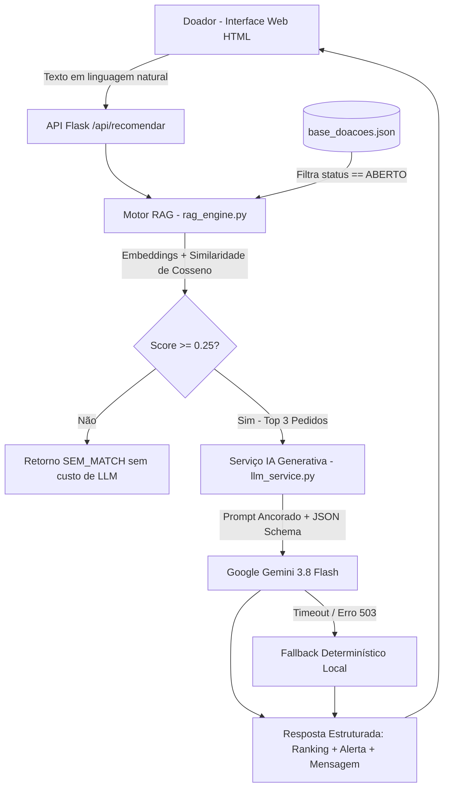

# SOLIA — Assistente Inteligente de Triagem e Match de Doações

> **Global Solution 2026/2 · FIAP — Disruptive Architectures: IoT, IoB & Generative IA**  
> **Tema:** CitizenTech

## Integrantes do Grupo
| Nome Completo              | RM       |
|:---------------------------|:---------|
| Guilherme Santos Fonseca   | RM564232 |
| Gustavo Araujo da Silva    | RM566526 |
| Anthony de Souza Henriques | RM566188 |


---

## 1. Problema e Aplicação CitizenTech
Muitos cidadãos desejam doar alimentos, roupas, móveis e itens de higiene, mas não sabem quais instituições próximas realmente precisam daqueles itens no momento, gerando desperdício logístico e doações incompatíveis.

O **SOLIA** resolve essa barreira atuando como um **Assistente Inteligente de Triagem e Match de Doações** integrado à modelagem da plataforma CitizenTech (`Instituição`, `Pedido de Ajuda`, `ItemPedido`, `Categoria` e `Avaliação`). O cidadão descreve em linguagem natural o que deseja doar, e o sistema encontra os pedidos de ajuda ativos mais compatíveis, valida regras de segurança/triagem e redige uma mensagem pronta para agendamento.

---

## 2. Arquitetura e Fluxo de Dados

A solução combina **RAG Básico (Retrieval-Augmented Generation)** com **IA Generativa (LLM)** e um mecanismo de contingência local para garantir alta disponibilidade:



### Organização e Preparação dos Dados (`data/base_doacoes.json`)
* **Origem:** Base sintética estruturada espelhando o modelo relacional da plataforma (`Instituição`, `Pedido de Ajuda`, `ItemPedido`, `Categoria`, `Avaliação` e coordenadas geográficas).
* **Pré-processamento e Regra de Negócio:** Antes da vetorização, o motor RAG filtra exclusivamente registros com `"status": "ABERTO"`, impedindo que campanhas já encerradas (`"status": "ENCERRADO"`) sejam recomendadas ao cidadão.
* **Indexação:** Cada pedido ativo é consolidado em um documento textual rico (categoria, descrição, itens/quantidades e endereço da instituição) e convertido em embeddings normalizados ($L_2$).

---

## 3. Modelos, Tecnologias e Justificativas Técnicas

| Camada | Tecnologia / Modelo | Justificativa Técnica |
| :--- | :--- | :--- |
| **Back-end & UI** | Python 3, Flask, HTML5/CSS3 | Arquitetura leve, modular e de fácil reprodução local sem dependências pesadas. |
| **RAG (Embeddings)** | `sentence-transformers` (`paraphrase-multilingual-MiniLM-L12-v2`) | Execução 100% local e gratuita, com excelente compreensão semântica em português (reconhece sinônimos como *"agasalhos"* e *"roupas infantis"*) e cálculo rápido de similaridade de cosseno via `NumPy`. |
| **IA Generativa** | Google Gemini (`gemini-3.8-flash`) via SDK `google-genai` | Baixa latência, suporte nativo a `response_mime_type="application/json"` para saída estruturada confiável e alta capacidade de raciocínio para triagem de itens impróprios. |
| **Resiliência** | Timeout (8s) + Fallback Local | Evita travamentos na interface em caso de picos de demanda (`HTTP 503`) na API externa. |

---

## 4. Avaliação dos Resultados e Métricas

Para validar o comportamento do sistema, foi desenvolvido o script automatizado `tests/avaliar_modelo.py` contemplando 6 cenários representativos (matches diretos, sinônimos semânticos, triagem de itens de risco, entradas fora de escopo e respeito à regra de pedidos encerrados).

### Tabela de Resultados Obtidos

| Caso de Teste | Cenário Avaliado | Pedido Recuperado (RAG) | Score Cosseno | Status IA | Tempo | Resultado |
| :--- | :--- | :--- | :---: | :---: | :---: | :---: |
| **TC01** | Match Direto (Alimentos) | `#101` (Esperado: `#101`) | `0.7139` | `APROVADO` | 8.93s | OK |
| **TC02** | Match Semântico / Sinônimos (Vestuário) | `#102` (Esperado: `#102`) | `0.5940` | `APROVADO` | 9.39s | OK |
| **TC03** | Match de Urgência (Eletrodoméstico) | `#103` (Esperado: `#103`) | `0.4376` | `APROVADO` | 10.16s | OK |
| **TC04** | Situação de Risco (Remédios/Comida vencida) | `#101` (Esperado: `#101`) | `0.3119` | `ATENCAO` | 9.32s | OK |
| **TC05** | Fora de Escopo (Peças de avião/combustível) | `None` (Esperado: `None`) | `0.0000` | `SEM_MATCH` | 0.02s | OK |
| **TC06** | Filtro de Negócio (Ignorar `#106` ENCERRADO) | `#101` (Esperado: `#101`) | `0.3700` | `APROVADO` | 12.15s | OK |

### Métricas Consolidadas
* **Precisão Top-1 do RAG (Retrieval Accuracy):** `100.0% (6/6)`
* **Acurácia de Triagem e Tratamento de Falhas:** `100.0% (6/6)`
* **Latência Média End-to-End:** `8.33s` (e `0.02s` para rejeição imediata de entradas fora de escopo via limiar de similaridade)

---

## 5. Uso Responsável e Limitações da IA
* **Proteção de Credenciais e Privacidade (LGPD):** Nenhuma chave de API é versionada no repositório (`.env` listado no `.gitignore`, disponibilizando apenas `.env.example`). Os dados utilizados são sintéticos e não expõem CPFs ou dados sensíveis de cidadãos reais.
* **Mitigação de Alucinações:** O prompt restringe a LLM exclusivamente ao contexto retornado pelo RAG (`temperature=0.2`).
* **Limitações Conhecidas:**
  1. **Cálculo Geográfico:** A proximidade atual depende da menção textual ao bairro/cidade na descrição; em produção, recomenda-se aplicar a fórmula de Haversine utilizando `latitude` e `longitude` antes do ranqueamento final.
  2. **Dependência de API Externa:** Oscilações na API da LLM acionam o modo de contingência local, que mantém a funcionalidade operacional, porém com textos de justificativa menos personalizados.
  3. **Verificação Física:** A IA orienta sobre boas práticas (validade e estado de conservação), mas a inspeção física final permanece sob responsabilidade da instituição receptora.

---

## 6. Como Executar o Projeto

1. **Clone o repositório e acesse a pasta:**
   ```bash
   git clone <URL_DO_REPOSITORIO>
   cd solia
   ```
2. **Crie e ative o ambiente virtual:**
   ```bash
   python -m venv venv
   # Windows (PowerShell):
   .\venv\Scripts\Activate.ps1
   # Linux/Mac:
   source venv/bin/activate
   ```
3. **Instale as dependências:**
   ```bash
   pip install -r requirements.txt
   ```
4. **Configure a chave de API:**
   * Copie `.env.example` para `.env` e insira sua chave gratuita do Google AI Studio em `GEMINI_API_KEY`.
5. **Execute a aplicação web:**
   ```bash
   python app.py
   ```
   Acesse `http://127.0.0.1:5000` no navegador.
6. **Execute a bateria de avaliação:**
   ```bash
   python tests/avaliar_modelo.py
   ```